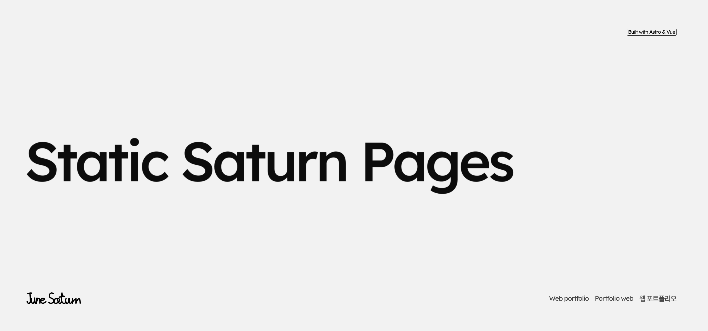

# 🪐 STATIC SATURN PAGES
##### [junesaturn.me](https://junesaturn.me)

---

### OVERVIEW

**Static Saturn Pages** is a front-end project: a portfolio website that brings together my work—especially my gameography—and a short bio in one place.

### FEATURES

##### 📐 DESIGN

- Minimalist aesthetic.
- Responsive layout.

##### 💻 TECH

- Hosted on GitHub Pages.
- Built with [Astro](https://github.com/withastro/astro) and [Vue.js](https://github.com/vuejs/core) using a component-based structure for clean, readable code.
- Written in TypeScript.

---

Copyright © 2026 June Saturn. All rights reserved. 